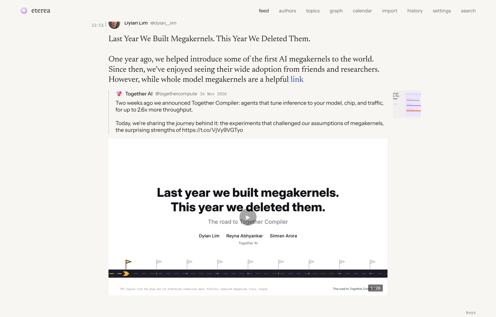
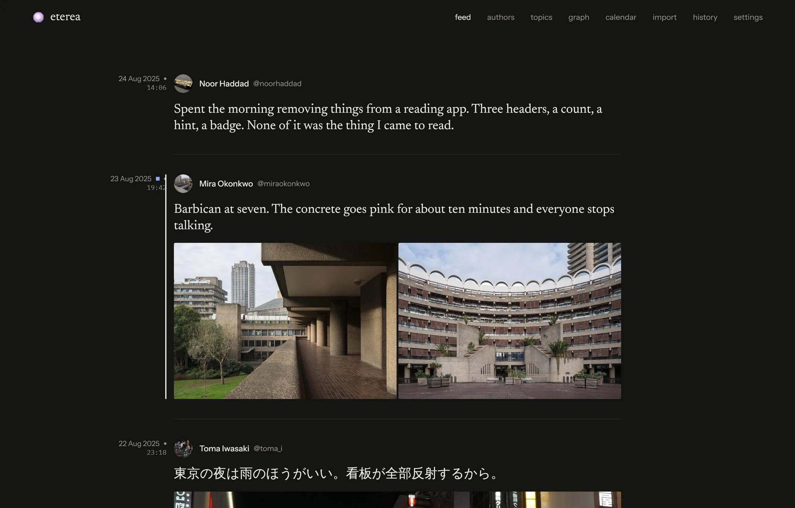
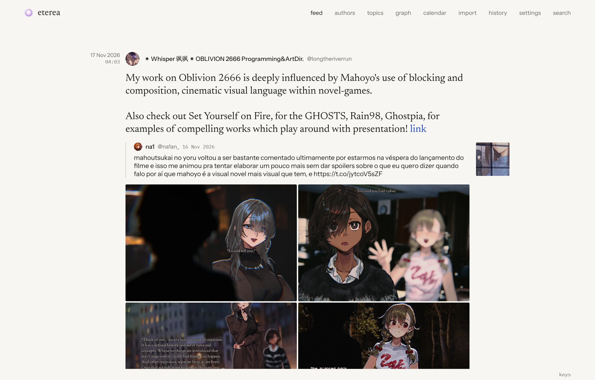
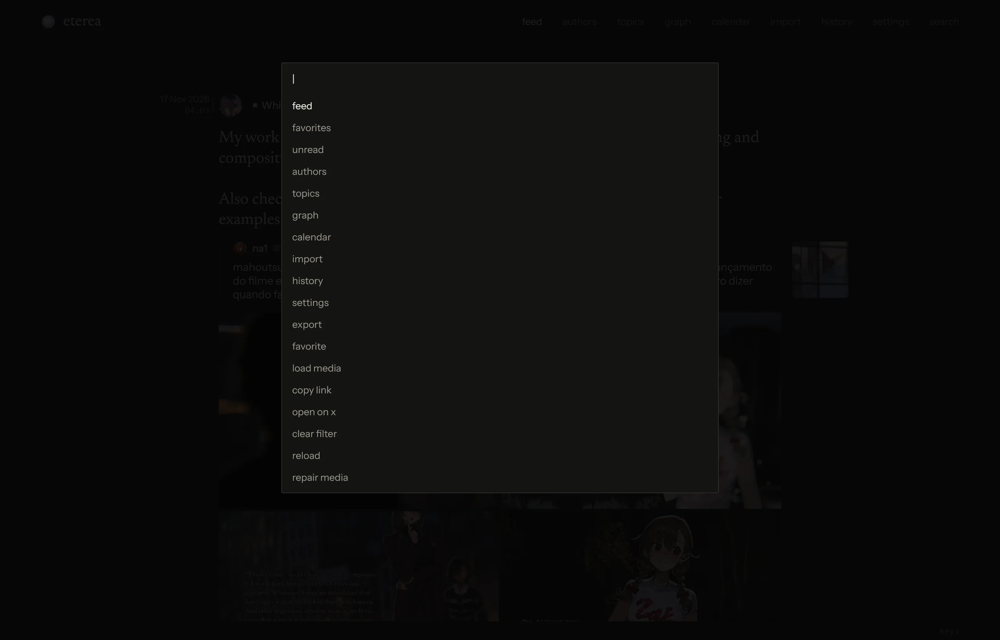
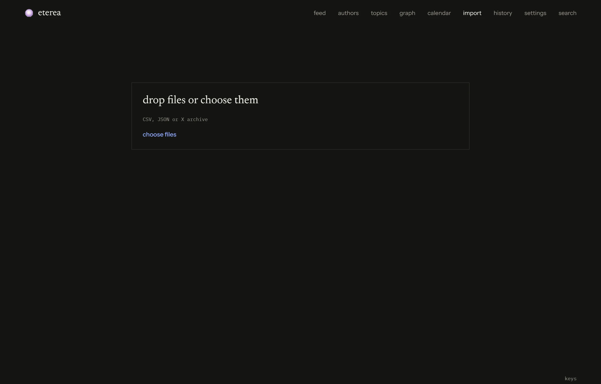
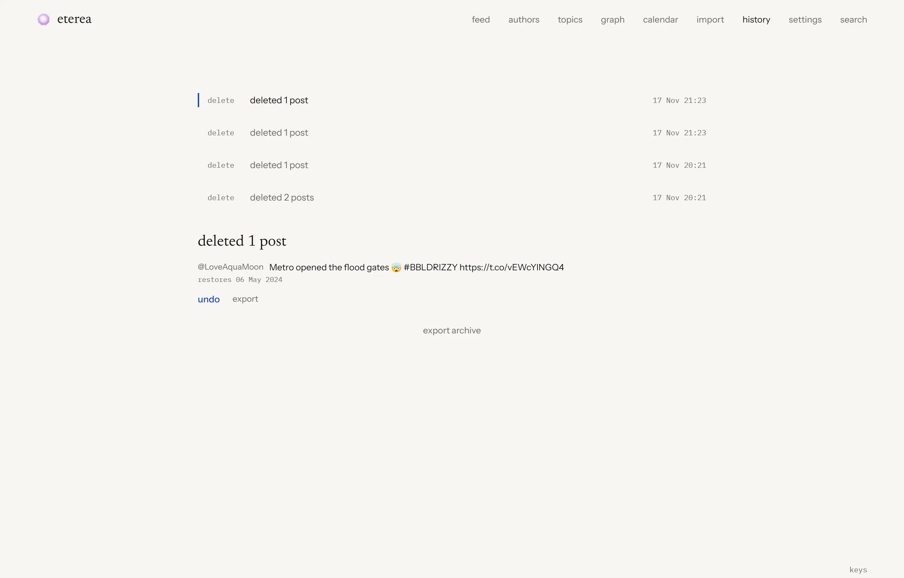
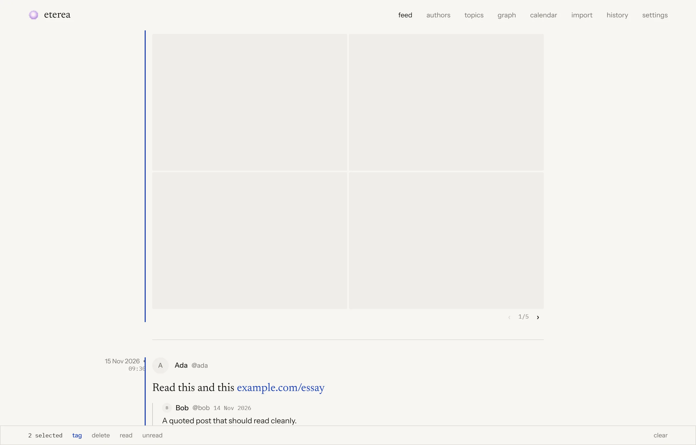
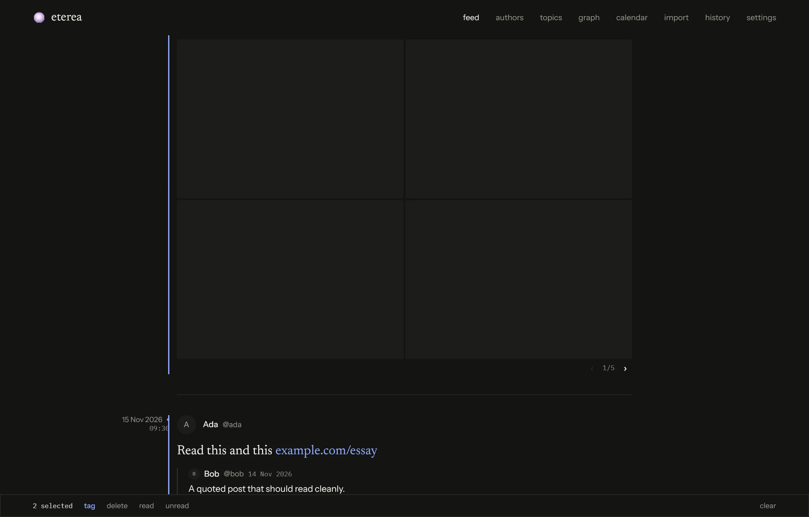
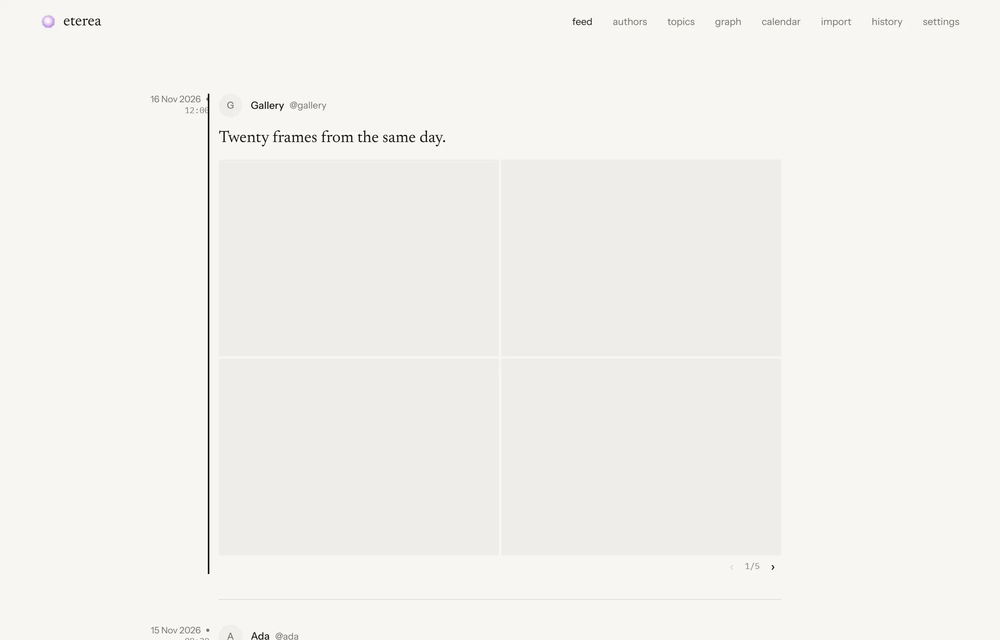
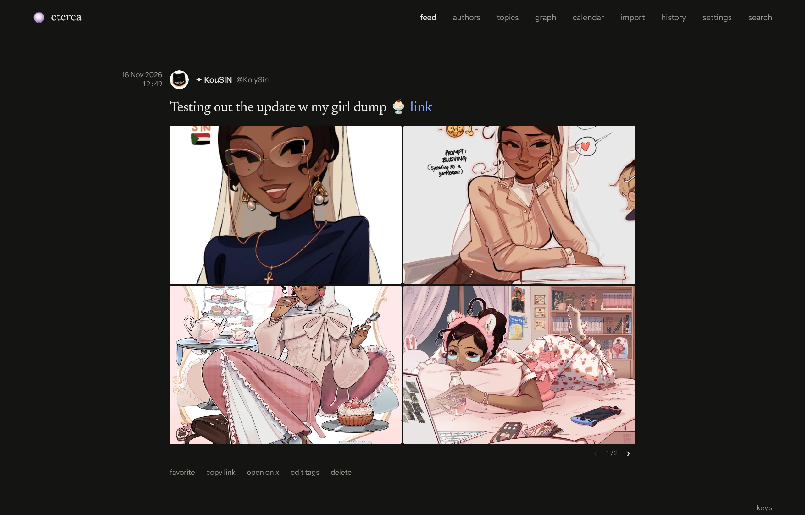

<div align="center">

<picture>
  <source media="(prefers-color-scheme: dark)" srcset="docs/assets/brand/eterea-orb-light.svg">
  
</picture>

<h1>eterea</h1>

<p><i>A local archive for the posts you save on X.</i></p>

<p>
  <a href="https://github.com/meillaya/eterea/stargazers"></a>
  <a href="https://github.com/meillaya/eterea/actions/workflows/ci.yml"></a>
  <a href="LICENSE"></a>
  <a href="https://www.rust-lang.org"></a>
  <a href="https://github.com/anomalyco/rune"></a>
  <a href="https://sqlite.org"></a>
</p>

<picture>
  <source media="(prefers-color-scheme: dark)" srcset="docs/assets/previews/hero-dark.webp">
  
</picture>

</div>

eterea imports X bookmarks from CSV, JSON or an X archive `.zip` directly, keeps them
in SQLite, and draws the archive with Rune on the GPU. There is no account and no
server. The desktop app is keyboard first, with a selection rule, a command
palette, search and a key sheet.

Screenshots are captures of the maintainer's live archive (11,841 posts).

The application is Rust. The verification harness and release scripts are Python
and Shell, and the development shell is Nix; the GitHub language bar reflects all
four.

---

## Screenshots

| Daylight | Night |
|:---:|:---:|
|  |  |
|  |  |
|  |  |
|  |  |
|  |  |
|  |  |
|  |  |
|  |  |
|  |  |
|  |  |
|  |  |

Photograph credits: [`CREDITS.md`](docs/assets/previews/CREDITS.md).

---

## Installation

### Release binary

Draft release tarballs are built by the tag workflow:

<https://github.com/meillaya/eterea/releases>

The tarball contains `eterea`, `eterea-launcher`, non-GPU runtime libraries in
`lib/`, a desktop entry and hicolor icons in `share/`, plus `PROVENANCE.md` and
`SHA256SUMS`. It requires x86_64 Linux with glibc 2.39 or newer and the host's
Vulkan/GL drivers; glibc and the GPU stack are deliberately not bundled. It is
not signed. Run `./eterea` (or `./eterea-launcher` on a distribution whose loader
path differs) from the unpacked directory; the launcher is also what the desktop
entry uses. Video playback needs `ffmpeg` and `ffplay` on `PATH`.

### From source

The development shell pins Rust 1.99.1 and supplies the native libraries Rune
needs:

```bash
git clone https://github.com/meillaya/eterea
cd eterea
devenv shell -- cargo run -p eterea-desktop
```

For a release build:

```bash
devenv shell -- bash scripts/package-linux-release.sh
./dist/eterea-*/eterea
```

The packager collects the display/font/Vulkan libraries Rune loads at runtime and
sets a `$ORIGIN/lib` runpath. A bare `devenv shell -- cargo build --release`
binary still expects the development shell's library path; use the packager for
a file-manager launch. See
[`scripts/RELEASE-LINUX.md`](scripts/RELEASE-LINUX.md) for the bundle layout,
launcher and smoke test.

With [mbx](https://mr-boxington.jdx.dev) installed, the same build can use its
shared compiler cache:

```bash
mbx build -p eterea-desktop --release
```

Build-space and headless render measurements are in
[`docs/performance.md`](docs/performance.md).

### First run

The header's `search` item and its footer `keys` hint are ordinary pointer
targets, so neither the search field nor the shortcut sheet takes a memorized
key to find.

The empty archive offers one action: import bookmarks. The importer accepts one
or many CSV, JSON or X archive files by picker or drag and drop, previews every
file, and writes the batch only after you confirm. Duplicate tweet URLs are
skipped. Repeat imports stay on the import screen so a second file does not
require a restart.

The archive lives at `<platform data dir>/eterea/bookmarks.db`. On Linux that is
`~/.local/share/eterea/bookmarks.db`. Preferences live in
`<platform config dir>/eterea/settings.json`, not in SQLite.

---

## What it does

- Imports CSV, JSON and X archive exports, one file or many, by picker or drop.
  Preview before write; a duplicate tweet URL is not re-inserted, but a richer
  source still backfills media, quotes, links, tags and the account's current
  name and avatar for it.
- Searches text, names, handles and tags over SQLite FTS5. The feed, and with it
  every search result, pages in as you scroll, so the whole archive is reachable
  rather than a demo cap. Author and topic lists filter and page the same way,
  with an inline filter field (`/` while the list is open).
- Loads avatars and media automatically for the visible archive, at the best
  rendition, through a bounded disk cache. Portraits resolve per account: the
  newest known avatar is shown everywhere, with older renditions as fallbacks
  when X has deleted the current one. Images and video files are cached
  outside SQLite; the cache can be measured and cleared in settings. The media
  queue retries keys that arrive while it is full instead of dropping them.
- Renders X media carousels up to 20 items, with a lightbox across the whole set.
  Tweet and quote URLs are removed from the reading surface; external links keep
  their display URL and quotes show as cards.
- Plays progressive MP4 video from the persistent cache with `ffmpeg`, with
  `ffplay` audio when unmuted. Sound starts off; `m` toggles it.
- Edits tags and deletes posts from the viewer. Marks read or unread, selects a
  page or the whole matching archive, and applies tags, deletion, read or unread
  to the selection.
- Keeps the last five import, delete and tag actions in History. The newest can
  be undone from its exact before-state; older actions stay visible with detail.
- Repairs missing media and quotes on demand: posts imported from a text-only
  export can be filled in from the public embed payload X serves for embedded
  posts (media list, quoted post, expanded links, hashtags, current author
  name/avatar). Opt-in via the `repair media` palette command; the footer shows
  a slim progress bar, `cancel` (or the palette's `cancel repair`) stops it, and
  `esc` keeps doing normal navigation. Deleted and protected posts are skipped,
  and media bytes still fill the normal cache when shown.
- Exports the archive, the current filter or the selection as CSV or JSON, with
  round-trippable nested data.
- Keeps quotes, favorites, media metadata, an interactive tag graph with persisted
  colors, and a calendar month.
- Imports honestly: the X archive `.zip` is read entry by entry, real progress
  shows while files are read and posts saved, `esc` cancels before the write,
  each file in a batch is reported separately (parse failures do not abort the
  rest), and the dry-run duplicate estimate uses exactly the insert's rules.
- Reconstructs threads when the export carries conversation ids (X API v2
  `conversation_id`) and shows the whole thread in detail, oldest first, with the
  opened post highlighted; archives without thread ids open the single post as
  before.
- Opens media in a lightbox with a `n / m` count, pointer and mouse-back paging,
  wheel/`+`/`-`/`0` zoom from fit to 3×, and video scrubbing with `,`/`.` (±5s,
  restart-at-offset) with a live position/duration readout.
- Keeps filters as reusable saved searches: compose query, tags, author, date,
  read/favorite and media facets into one predicate, save it under a name, and
  remove facets from the chip line; `add tag filter` composes tags.
- Flags posts that X reports as gone: a quiet “no longer available on x” line in
  the feed and detail (with an explanation that the tweet was deleted, protected
  or its account no longer exists). The opt-in `check availability` pass fills
  those flags and can be cancelled; a later successful check clears them.
- Curates tags: `rename tag` renames a tag on the selected post (merging into an
  existing tag folds both together, with autocomplete suggestions), `prune tags`
  removes unused tags, and per-tag colours can be reset to their seeded colour.
- Lets you read in order: `cmd-n` / `next unread` opens the next unread post and
  marks the current one read; when the view runs out it switches to the unread
  filter and starts again.
- Keeps private notes: `n` (or `edit note`) opens a note editor for the selected
  post; notes appear in the detail view, search across them, and round-trip
  through CSV/JSON exports.
- Makes deletes recoverable: every delete keeps a full snapshot in a bounded
  trash (`restore last deleted` in the palette), and undo (`u`) walks back
  through recent actions instead of stopping at one.
- Protects the archive: a consistent copy is written before every migration
  pass (the newest five rotate), `backup now` makes a manual copy, a palette
  `check integrity` runs SQLite's integrity and foreign-key checks, and
  `restore backup` validates a chosen copy byte-for-byte before replacing the
  live archive page-wise.
- Browses the archive on a calendar: month grid with a selected-week rule and
  per-day marks, a year overview of twelve month plates whose dots shade with
  saved-post density, `‹ ›` month chevrons, `[`/`]`, `t` for today and `y` for
  the year view.
- Remembers the window's size and position, refuses a second instance on the
  same profile, writes `settings.json` atomically, and shows the database path,
  backup count, tool availability and a retry for media that hit a transient
  network failure.
- `g g` / `G` jump to the top/end of the feed, a visible `filtered: …` line
  says when a filter is on and offers `clear`, and `retry media` re-requests
  images that failed for network reasons.
- Switches between system, light and dark appearance, three text sizes, automatic
  or on-demand media, and system or reduced motion. Preferences persist.
- Ships a Verus reference model, bounded Kani harnesses, Miri tests and fuzz
  targets for the pure crates and import parsers, plus a headless UI matrix. This
  is not whole-app verification; see
  [verification/COVERAGE.md](verification/COVERAGE.md).

---

## Shortcuts

| Key | Action |
|:---|:---|
| `j` `k` | Move selection |
| `Enter` | Open the selected post |
| `Esc` | Close the overlay, then search, then detail |
| `/` | Search the feed |
| `:` | Command palette |
| `?` | Key sheet |
| `f` | Favorite |
| `c` | Copy link |
| `o` | Open on X |
| `m` | Load media, or toggle video sound |
| `Space` | Play or pause video |
| `←` `→` | Page the carousel, or move in the lightbox |
| `x` | Select the current post and enter selection mode |
| `Shift-j` `Shift-k` | Extend the selection |
| `Cmd/Ctrl-A` | Select the current page |
| `Shift-Cmd/Ctrl-A` | Select everything matching the current filter |
| `t` | Edit tags; bulk tag in selection mode |
| `d` | Delete; bulk delete in selection mode |
| `u` / `r` | Mark unread / read |
| `h` | History and undo |
| `e` | Export |
| `Cmd/Ctrl-F` | Search |
| `Cmd/Ctrl-P` | Command palette |
| `Cmd/Ctrl-,` | Settings |
| mouse back / forward | Leave an overlay or step between routes |

The footer's `keys` hint opens the same shortcut sheet without the keyboard, and
`/` filters the authors or topics list when that route is open. Mouse
selections, bylines, tags, media and navigation work too.

---

## Repository

| Path | Purpose |
|:---|:---|
| `src/backend` | Models, parsers, SQLite storage, migrations, search. |
| `src/app` | Product operations and the background store actor. |
| `src/logic` | Pure URL and MIME policy. |
| `src/ui-model` | Pure routes, modes and keymap. |
| `src/media` | HTTPS image workers, image and video caches, video and audio playback. |
| `src/desktop` | Rune shell, theme, views and input. |
| `verification` | Verus, Kani and Miri harnesses, coverage and findings. |

[`docs/architecture.md`](docs/architecture.md) covers the crate boundaries and
trust boundaries. The UI contract is in
[`docs/design/SPEC.md`](docs/design/SPEC.md).

---

## Develop and verify

```bash
devenv shell -- cargo test --workspace
devenv shell -- cargo build -p eterea-desktop --release
bash scripts/verify/all.sh --strict --fast
FUZZ_TIME=10 bash scripts/verify/fuzz.sh
```

`verification/kani` and `verification/miri` are standalone crates, so they are
tested by the verification scripts rather than by `cargo test --workspace`. The
formula for the pure layers is in
[`docs/verification/formal-verification.md`](docs/verification/formal-verification.md).

Desktop UI captures are produced by Rune's headless compositor. The harness
command and its limits are in
[`docs/verification/ui-harness.md`](docs/verification/ui-harness.md).

---

## Privacy

Bookmark text, handles, tags and media URLs stay in the local SQLite file. Media
bytes are never stored in SQLite; images and played videos live in the local
cache and can be cleared. Avatars and visible media load automatically by
default; Settings can switch media back to on-demand. Fetches use HTTPS only,
without cookies or referrer, and a redirect is followed only when the next hop
is safe too. Stored links open only through an explicit action. Preferences are a
small JSON file. History payloads for the last five actions also stay local.

The optional `repair media` command is the only feature that fetches post data
from X after import. It uses X's public embed payload endpoint
(`cdn.syndication.twimg.com`), which needs no account, cookies or bearer token,
and only runs when the reader invokes it. It stores metadata in the archive and
never pre-downloads media bytes; the payload comes from an undocumented endpoint
that X may change or rate-limit at any time, and deleted or protected posts
cannot be recovered. If that is not acceptable, do not run the command: the
archive otherwise makes no network requests except for media you can see.

---

## License

MIT. See [LICENSE](LICENSE).
