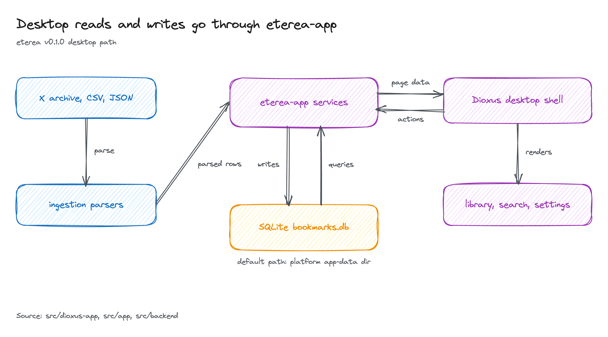

# Eterea

Eterea turns an X/Twitter bookmark export into a local, keyboard-driven reading
room. Import CSV, JSON, or an X archive JavaScript file, preview the parse, then
search and read the archive in a Dioxus desktop app backed by SQLite.

It is for people with thousands of saved posts who want a searchable archive on
their own disk. The shell follows terminal conventions: `1` to `6` switch tabs,
`/` searches, `:` opens commands, and `?` lists shortcuts.

## Quick start

```bash
devenv shell -- cargo run -p eterea-dioxus
```

Press `5` to open Import and paste the path to your export. Preview reports the
format, bookmark count, source, and sample rows before the import writes
anything. The default database is `eterea/bookmarks.db` under the platform
app-data directory.

<p align="center">
  
  
</p>

## What it does

The import path accepts CSV, JSON, and X archive JavaScript exports and skips
duplicate tweet URLs. The library has search, author and topic directories,
favorites, entry detail, and five views: table, tree, dashboard, graph, and
calendar. Filters cover text, author, date range, tag, favorites, and media
presence.

Remote image previews stay hidden until you load one tweet or enable images for
the session. Eterea stores media metadata from the export (alt text, dimensions,
source keys, preview URLs, and variants) so rows can reserve space and label
previews. The database stores metadata and URLs; the schema has no column for
media bytes.

## Architecture

The desktop shell calls `eterea-app` for every read and write. `eterea-app` owns
import, query, and mutation operations; `eterea-core` provides the parsers,
SQLite storage, search, and statistics; and `eterea-dioxus` renders the shell.
Imports cross the same service boundary, so UI code calls the service layer and
SQL stays in `eterea-core`.



The scene source is
[docs/figures/eterea-architecture.excalidraw](docs/figures/eterea-architecture.excalidraw).
See the [architecture document](docs/architecture.md) for trust boundaries and
the persistence contract.

## Privacy model

Bookmark data stays in SQLite on your machine. Eterea parses and queries the
archive in process, and it stores media metadata without caching image bytes.
Remote previews remain hidden until you load one tweet or enable images for the
session. Opening a stored link requires an explicit action and an HTTPS URL.

## Develop and verify

The devenv shell supplies the Rust toolchain and the native desktop libraries.
CI runs these gates:

```bash
devenv shell -- cargo fmt --all -- --check
devenv shell -- cargo clippy --workspace --all-targets -- -D warnings
devenv shell -- cargo test --workspace
devenv shell -- cargo build -p eterea-dioxus --release
devenv shell -- scripts/perf-baseline.sh
```

The documentation link check is local:

```bash
python3 scripts/check-doc-links.py README.md 'docs/**/*.md' CHANGELOG.md
```
