<div align="center">

<picture>
  <source media="(prefers-color-scheme: dark)" srcset="docs/assets/brand/eterea-orb-light.svg">
  
</picture>

<h1>eterea</h1>

<p><i>A local archive for the posts you save on X.</i></p>

<p>
  <a href="https://github.com/meillaya/eterea/stargazers"></a>
  <a href="https://github.com/meillaya/eterea/actions/workflows/ci.yml"></a>
  <a href="LICENSE"></a>
  <a href="https://www.rust-lang.org"></a>
  <a href="https://github.com/anomalyco/rune"></a>
  <a href="https://sqlite.org"></a>
</p>

<picture>
  <source media="(prefers-color-scheme: dark)" srcset="docs/assets/previews/hero-dark.webp">
  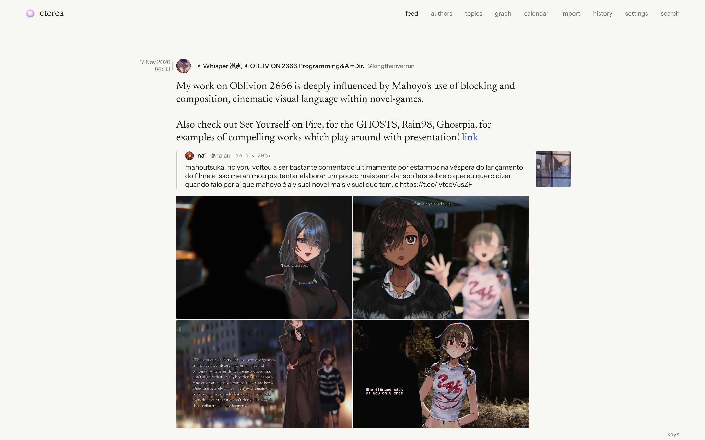
</picture>

</div>

eterea imports X bookmarks from CSV, JSON or an X archive `.zip` directly, keeps them
in SQLite, and draws the archive with Rune on the GPU. There is no account and no
server. The desktop app is keyboard first, with a selection rule, a command
palette, search and a key sheet.

Screenshots are captures of the maintainer's live archive (11,841 posts).

The application is Rust. The verification harness and release scripts are Python
and Shell, and the development shell is Nix; the GitHub language bar reflects all
four.

---

## Screenshots

| Daylight | Night |
|:---:|:---:|
|  |  |
|  | 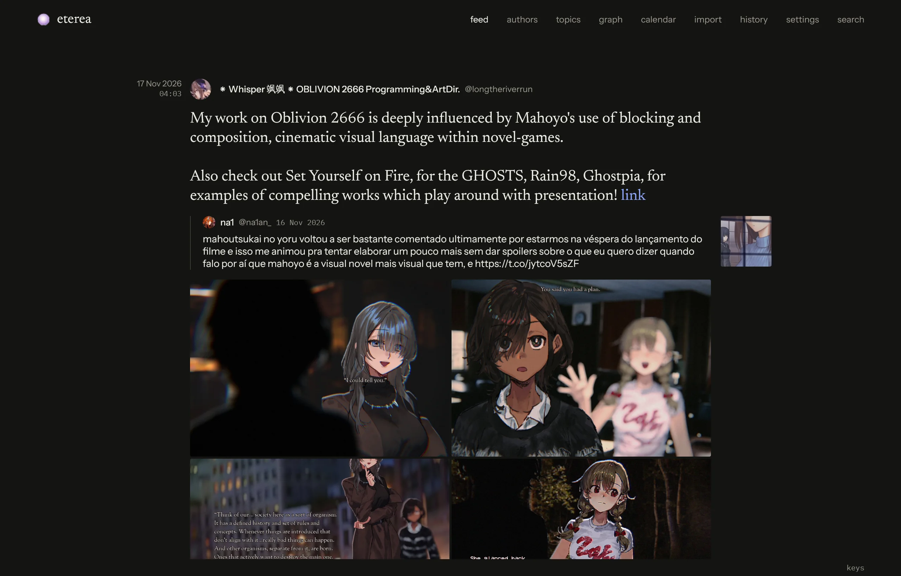 |
| 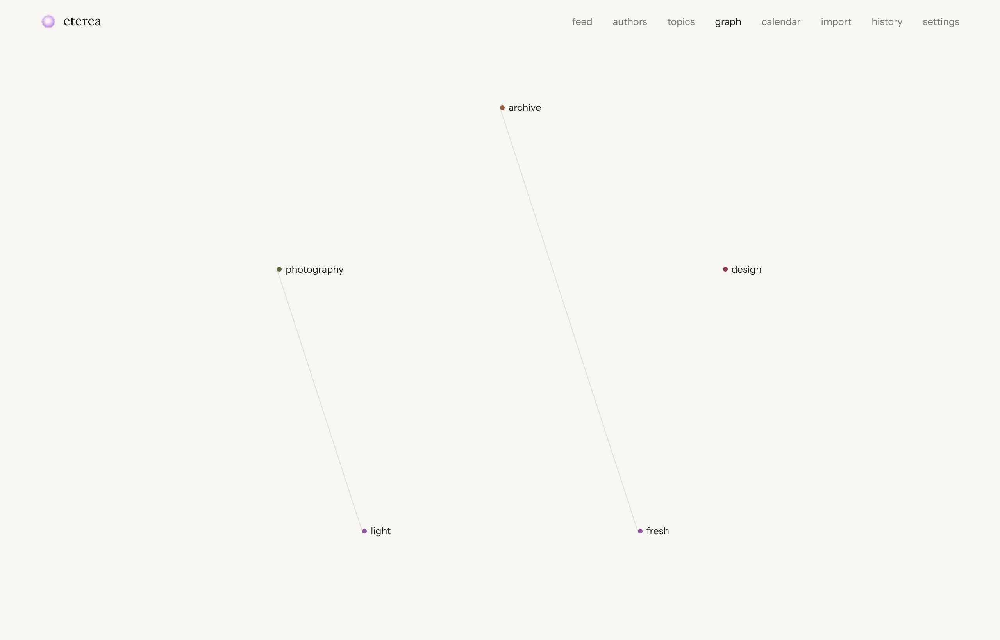 | 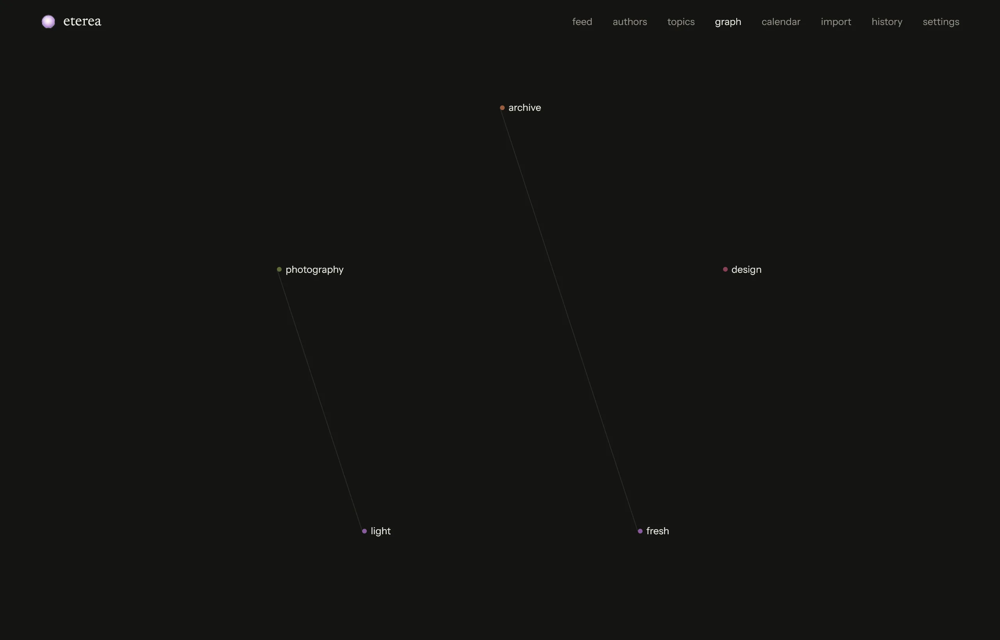 |
| 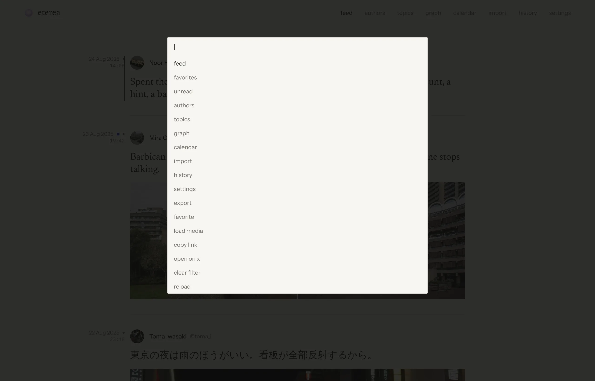 |  |
| 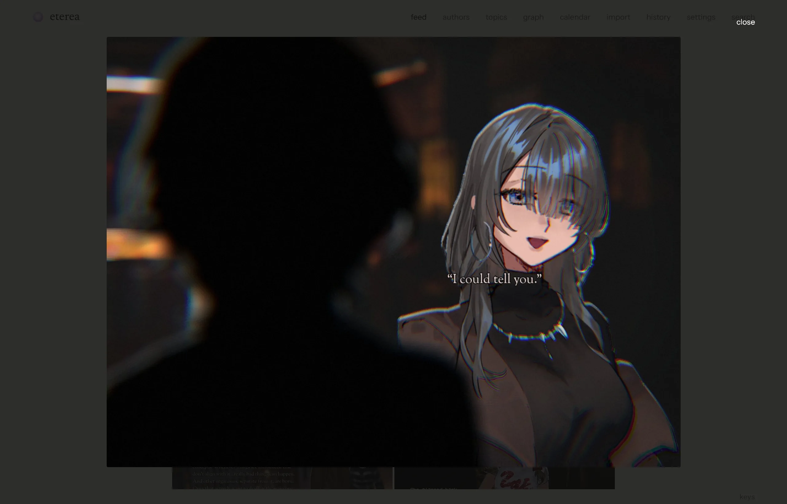 | 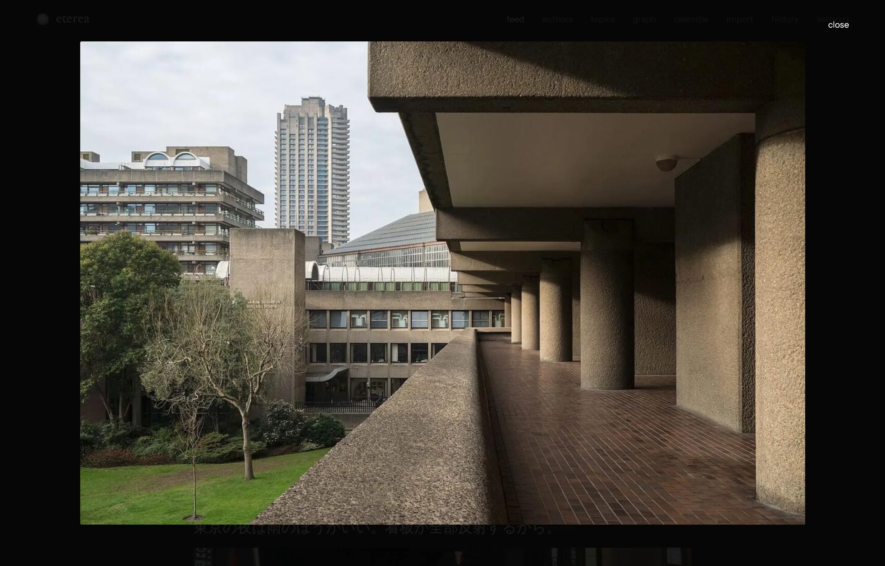 |
| 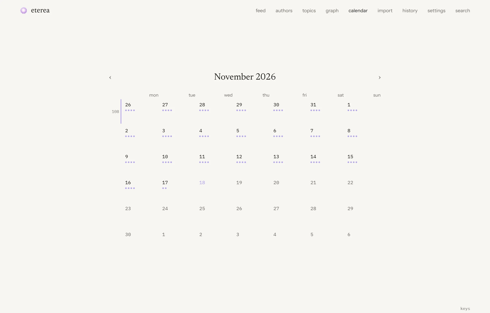 | 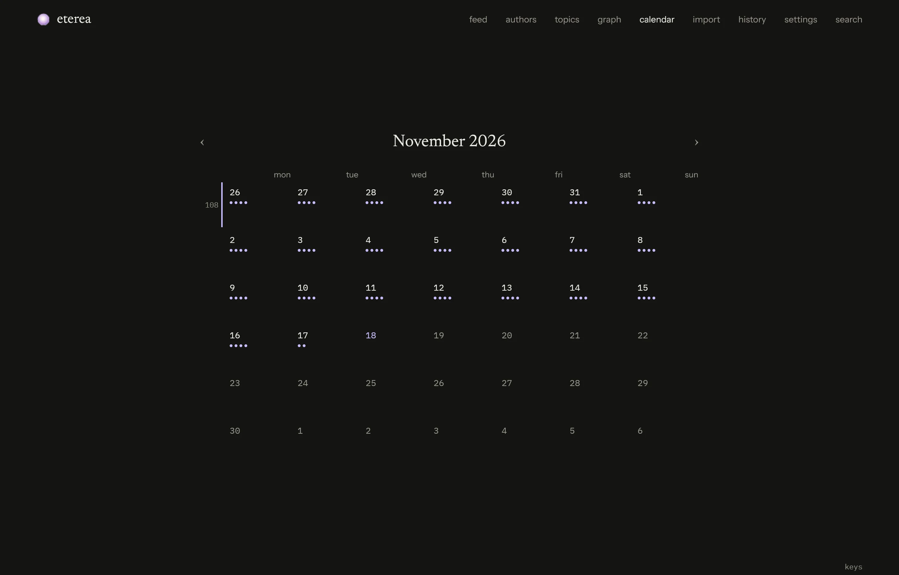 |
| 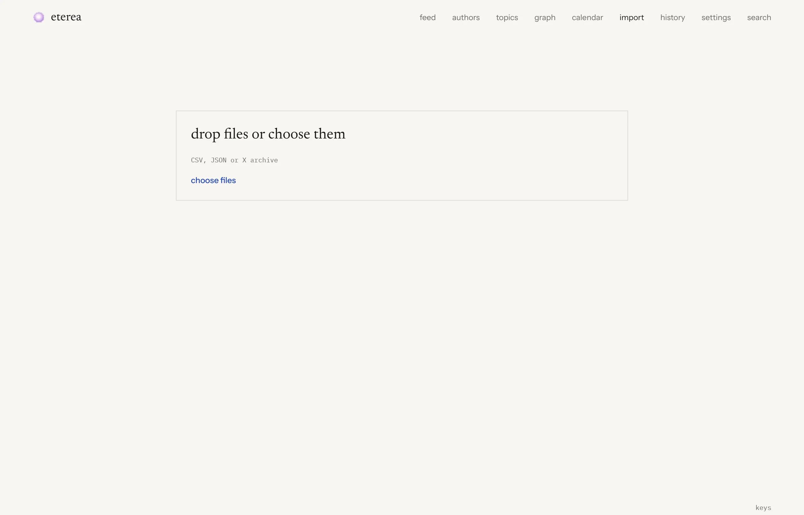 |  |
|  | 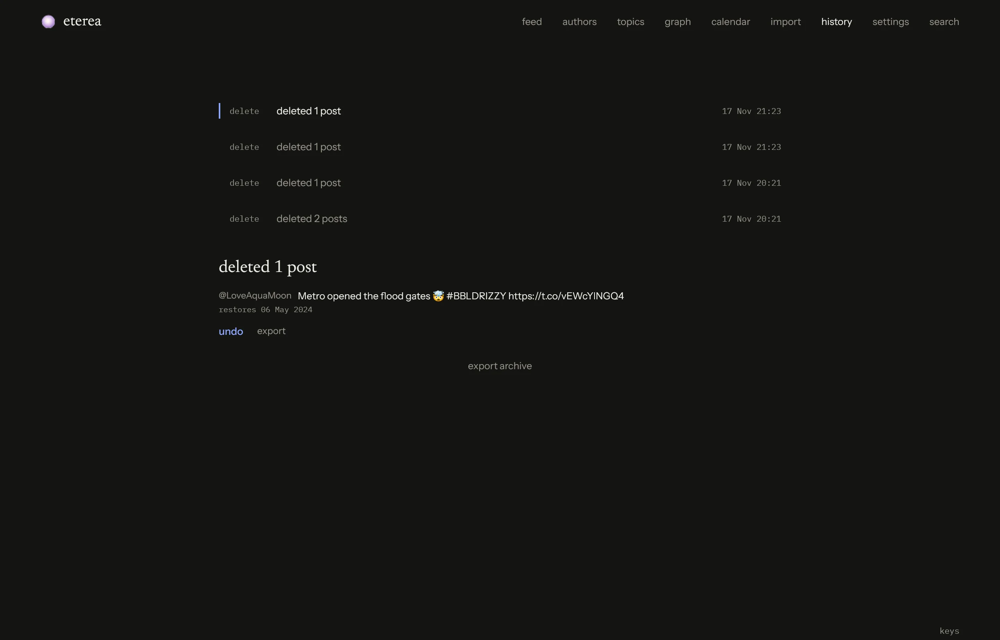 |
| 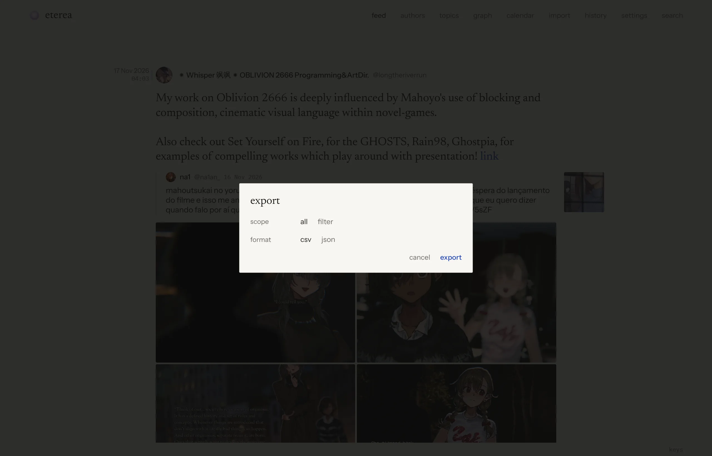 | 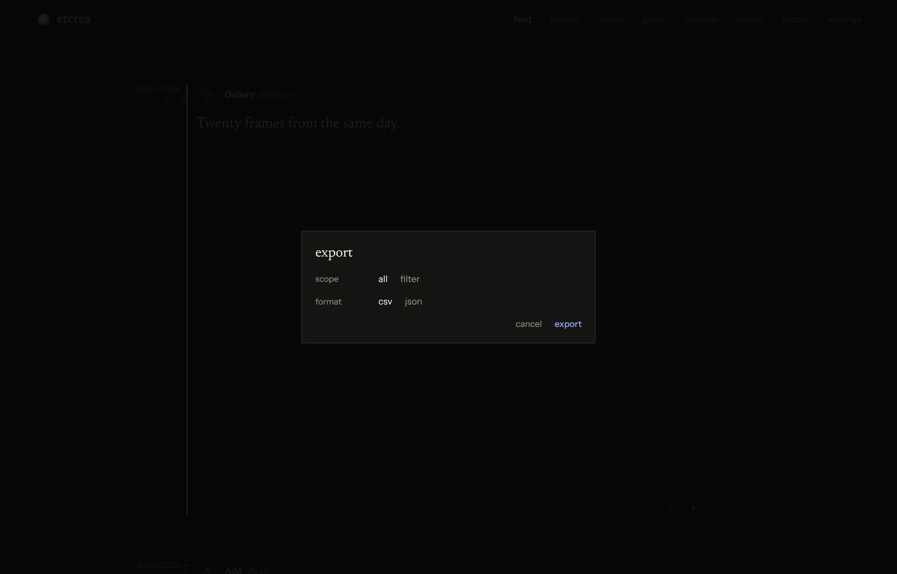 |
|  |  |
|  |  |

Photograph credits: [`CREDITS.md`](docs/assets/previews/CREDITS.md).

---

## Installation

### Release binary

Draft release tarballs are built by the tag workflow:

<https://github.com/meillaya/eterea/releases>

The tarball contains `eterea`, `eterea-launcher`, non-GPU runtime libraries in
`lib/`, a desktop entry and hicolor icons in `share/`, plus `PROVENANCE.md` and
`SHA256SUMS`. It requires x86_64 Linux with glibc 2.39 or newer and the host's
Vulkan/GL drivers; glibc and the GPU stack are deliberately not bundled. It is
not signed. Run `./eterea` (or `./eterea-launcher` on a distribution whose loader
path differs) from the unpacked directory; the launcher is also what the desktop
entry uses. Video playback needs `ffmpeg` and `ffplay` on `PATH`.

### From source

The development shell pins Rust 1.99.1 and supplies the native libraries Rune
needs:

```bash
git clone https://github.com/meillaya/eterea
cd eterea
devenv shell -- cargo run -p eterea-desktop
```

For a release build:

```bash
devenv shell -- bash scripts/package-linux-release.sh
./dist/eterea-*/eterea
```

The packager collects the display/font/Vulkan libraries Rune loads at runtime and
sets a `$ORIGIN/lib` runpath. A bare `devenv shell -- cargo build --release`
binary still expects the development shell's library path; use the packager for
a file-manager launch. See
[`scripts/RELEASE-LINUX.md`](scripts/RELEASE-LINUX.md) for the bundle layout,
launcher and smoke test.

With [mbx](https://mr-boxington.jdx.dev) installed, the same build can use its
shared compiler cache:

```bash
mbx build -p eterea-desktop --release
```

The repository also carries a Nix flake. To try the app without installing
anything (the first run needs network to vendor the pinned Cargo dependencies):

```bash
nix run .#
```

To build the packaged binary instead (Linux):

```bash
nix build .#default
./result/bin/eterea
```

The output installs `eterea`, `eterea-cli`, a desktop entry and hicolor icons,
and points the binary at the host's driver libraries. The flake only builds the
package; the development shell stays with devenv above.

Build-space and headless render measurements are in
[`docs/performance.md`](docs/performance.md).

### First run

The header's `search` item and its footer `keys` hint are ordinary pointer
targets, so neither the search field nor the shortcut sheet takes a memorized
key to find.

The empty archive offers one action: import bookmarks. The importer accepts one
or many CSV, JSON or X archive files by picker or drag and drop, previews every
file, and writes the batch only after you confirm. Duplicate tweet URLs are
skipped. Repeat imports stay on the import screen so a second file does not
require a restart.

The archive lives at `<platform data dir>/eterea/bookmarks.db`. On Linux that is
`~/.local/share/eterea/bookmarks.db`. Preferences live in
`<platform config dir>/eterea/settings.json`, not in SQLite.

---

## What it does

eterea imports your X bookmarks from CSV, JSON or an X archive `.zip` into a
local SQLite archive, then gives you a keyboard-first reader for it: FTS5
search, media and carousels, threads, tags, a calendar and tag graph,
recoverable deletes, history and undo, exports, and opt-in metadata repair. It
runs entirely on this machine, with no account and no server.

The full feature list is in [`docs/features.md`](docs/features.md).

---

## Shortcuts

| Key | Action |
|:---|:---|
| `j` `k` | Move selection |
| `Enter` | Open the selected post |
| `Esc` | Close the overlay, then search, then detail |
| `/` | Search the feed |
| `:` | Command palette |
| `?` | Key sheet |
| `f` | Favorite |
| `c` | Copy link |
| `o` | Open on X |
| `m` | Load media, or toggle video sound |
| `Space` | Play or pause video |
| `←` `→` | Page the carousel, or move in the lightbox |
| `x` | Select the current post and enter selection mode |
| `Shift-j` `Shift-k` | Extend the selection |
| `Cmd/Ctrl-A` | Select the current page |
| `Shift-Cmd/Ctrl-A` | Select everything matching the current filter |
| `t` | Edit tags; bulk tag in selection mode |
| `d` | Delete; bulk delete in selection mode |
| `u` / `r` | Mark unread / read |
| `h` | History and undo |
| `e` | Export |
| `Cmd/Ctrl-F` | Search |
| `Cmd/Ctrl-P` | Command palette |
| `Cmd/Ctrl-,` | Settings |
| mouse back / forward | Leave an overlay or step between routes |

The footer's `keys` hint opens the same shortcut sheet without the keyboard, and
`/` filters the authors or topics list when that route is open. Mouse
selections, bylines, tags, media and navigation work too.

---

## Repository

| Path | Purpose |
|:---|:---|
| `src/backend` | Models, parsers, SQLite storage, migrations, search. |
| `src/app` | Product operations and the background store actor. |
| `src/logic` | Pure URL and MIME policy. |
| `src/ui-model` | Pure routes, modes and keymap. |
| `src/media` | HTTPS image workers, image and video caches, video and audio playback. |
| `src/desktop` | Rune shell, theme, views and input. |
| `verification` | Verus, Kani and Miri harnesses, coverage and findings. |

[`docs/architecture.md`](docs/architecture.md) covers the crate boundaries and
trust boundaries. The UI contract is in
[`docs/design/SPEC.md`](docs/design/SPEC.md).

---

## Develop and verify

```bash
devenv shell -- cargo test --workspace
devenv shell -- cargo build -p eterea-desktop --release
bash scripts/verify/all.sh --strict --fast
FUZZ_TIME=10 bash scripts/verify/fuzz.sh
```

`verification/kani` and `verification/miri` are standalone crates, so they are
tested by the verification scripts rather than by `cargo test --workspace`. The
formula for the pure layers is in
[`docs/verification/formal-verification.md`](docs/verification/formal-verification.md).

Desktop UI captures are produced by Rune's headless compositor. The harness
command and its limits are in
[`docs/verification/ui-harness.md`](docs/verification/ui-harness.md).

The repository also ships Verus reference models, bounded Kani harnesses, Miri
tests and fuzz targets for the pure crates and import parsers, plus a headless UI
matrix. This is not whole-app verification; see
[verification/COVERAGE.md](verification/COVERAGE.md).

---

## Privacy

Bookmark text, handles, tags and media URLs stay in the local SQLite file. Media
bytes are never stored in SQLite; images and played videos live in the local
cache and can be cleared. Avatars and visible media load automatically by
default; Settings can switch media back to on-demand. Fetches use HTTPS only,
without cookies or referrer, and a redirect is followed only when the next hop
is safe too. Stored links open only through an explicit action. Preferences are a
small JSON file. History payloads for the last five actions also stay local.

The optional `repair media` command is the only feature that fetches post data
from X after import. It uses X's public embed payload endpoint
(`cdn.syndication.twimg.com`), which needs no account, cookies or bearer token,
and only runs when the reader invokes it. It stores metadata in the archive and
never pre-downloads media bytes; the payload comes from an undocumented endpoint
that X may change or rate-limit at any time, and deleted or protected posts
cannot be recovered. If that is not acceptable, do not run the command: the
archive otherwise makes no network requests except for media you can see.

---

## License

MIT. See [LICENSE](LICENSE).
