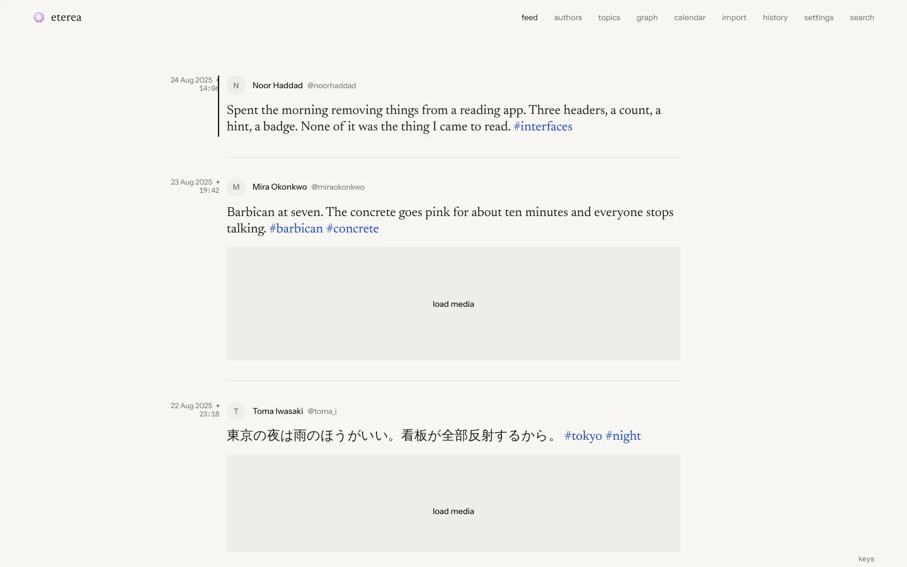
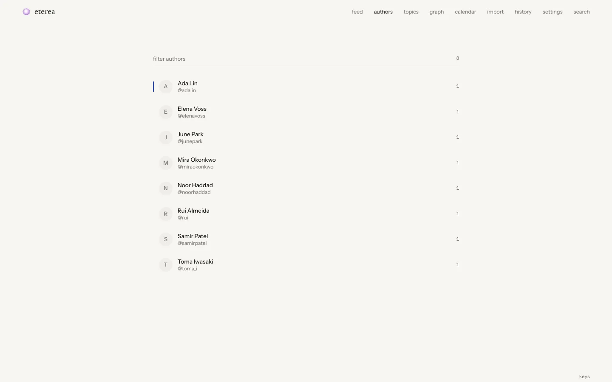
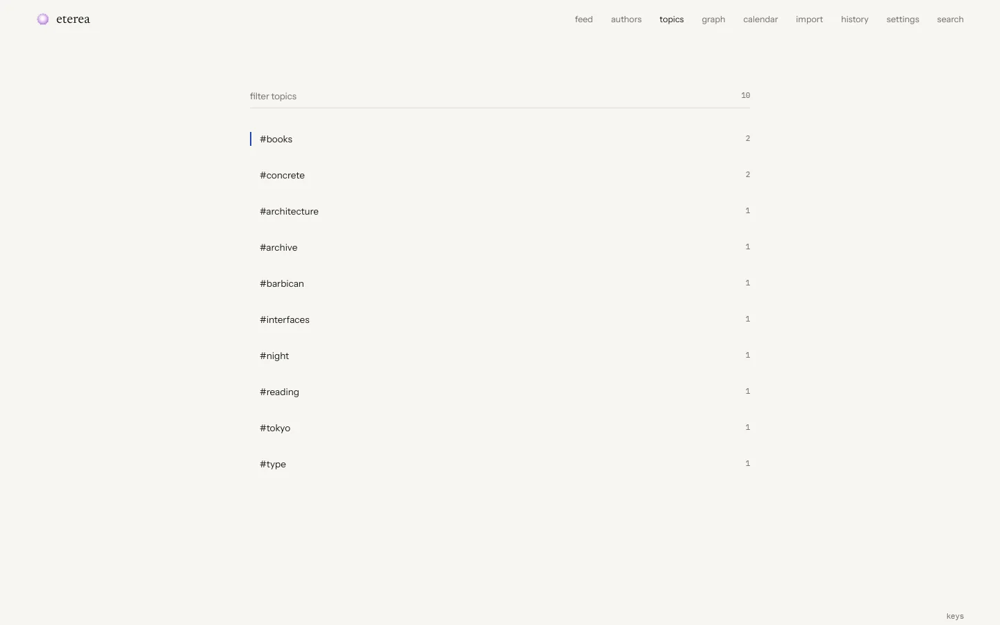
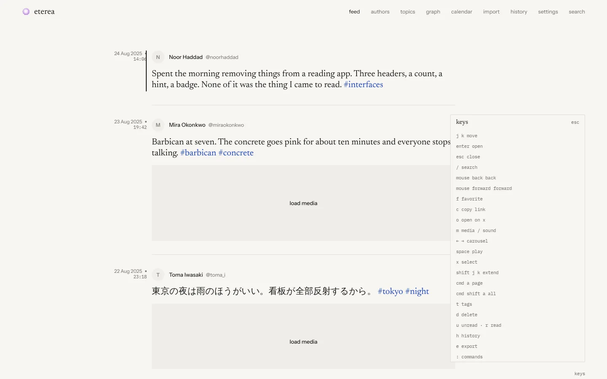
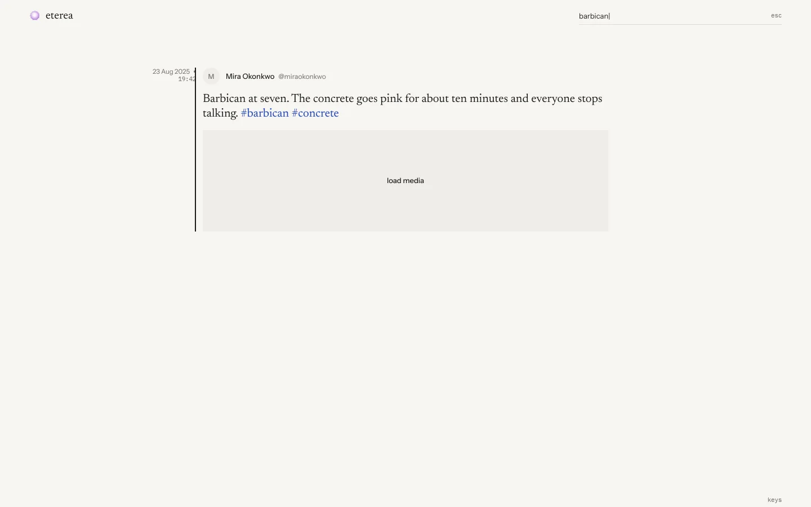

# eterea critical audit

Date: 2026-11-17. Scope: the whole repository (`src/backend`, `src/app`,
`src/logic`, `src/ui-model`, `src/media`, `src/desktop`), its verification
claims and its user-facing UX. This audit was run against commit `cacc575`
("Ship the v2 reader update") plus an uncommitted fix pass described in
[§2](#2-what-this-pass-fixed). Five independent workstreams audited the data
layer, the service layer, media, the desktop shell and the product surface; the
Lead re-verified every claim that affects user-visible behaviour, reproduced the
search defect against a copy of the live 11,846-post archive, and ran the
gates.

Raw, unabridged per-area evidence (gitignored): `.work/audit/findings-*.md`
(`core-data`, `app-store`, `media`, `desktop`, `product-ux`), plus
`.work/audit/shots/` for the captures in this report.

Short version: the architecture and the local-first privacy contract are
strong, and the verification story is unusually honest for a pre-release app.
But the reader's core loop had four defects the happy-path tests could not see
(the feed stopped at 48 posts, same-day posts had no vertical rhythm, search
was invisible and returned only the newest page, and the archive schema is
unreadable by any SQLite newer than the bundled one). Those are reproduced and
fixed in this pass. The next-highest risks are data-safety edges (import
parser field loss, timestamp corruption, no backup or trash) and the missing
"second half" of the reading workflow (threads, notes, tag management, an
unread queue).

---

## 1. Verdict

| Dimension | Assessment |
| --- | --- |
| Architecture and boundaries | Strong. One service boundary (`AppServices` + `StoreHandle`), pure logic crates, local-first, no account/server, media bytes never in SQLite. |
| Verification honesty | Strong. Verus/Kani/Miri/fuzz/UI matrix are scoped in `verification/COVERAGE.md` with explicit non-claims. Two claims are now stale and are fixed here (COVERAGE test counts, SPEC key-sheet generation). |
| Reader core loop | **Was broken in four places**, all user-visible and all fixed here: pagination, rhythm, search discoverability, search completeness. |
| Data safety | **Weakest area.** Import parser silent field loss and millisecond-epoch corruption are P1; there is no backup, integrity check, trash or multi-step undo. A single `bookmarks.db` is the whole archive. |
| Media robustness | **Fixed P1s here:** failed video decode no longer respawns ffmpeg forever; image MIME policy is enforced; queue overflow retries instead of blacklisting. Large-video downloads still cannot survive a slow link (20 s whole-body budget, no Range). |
| Product surface | Competitive as a *reading* surface; the missing workflows are organization (tag rename/merge, collections, unread queue), ingest (X-archive `.zip`, incremental import), and trust (backup/restore). |
| Gates at end of pass | `cargo test --workspace` and `cargo clippy --workspace --all-targets` pass; UI matrix passes with new scripted cases (see [§6](#6-gates-at-the-end-of-this-pass)). |

Severity counts across the five raw finding sets (before this pass's fixes):
no P0; **15 P1**, 23 P2, 14 P3, plus **45 UX feature/enhancement proposals**
and **45 documentation contradictions**. This pass closed **9 of the 15 P1s**
(the four user-reported reader defects, the media queue overflow, the video
respawn loop, and the three backend data-integrity defects including the
schema migration) plus one shell P0 found in adversarial review, and it fixed
the four documentation defects it touched.

---

## 2. What this pass fixed

All fixes below are in the working tree, verified by compile, the workspace
tests and headless captures. The user-reported defects are marked **user**.

### 2.1 Reader loop (desktop shell)

| ID | Defect (evidence at audit time) | Fix | Verification |
| --- | --- | --- | --- |
| **user** feed pagination | Every feed call hard-coded `offset: 0, limit: PAGE` (48) and replaced the post list; `page.has_more` was discarded and no scroll hook existed (`app.rs:485-509`, `feed_view` had no `on_at_bottom`). The archive past post 48 was unreachable. | `feed_query(offset)` + `load_more_feed()`; `feed_view` calls `on_at_bottom`; `Response::Feed` appends when `page.offset > 0` with id dedupe, replaces otherwise; stale replies are dropped by `RequestId` (`feed_request`). | Headless scroll test: page 2 appended; live-archive copy reachable. |
| **user** feed rhythm | `feed_view` had no gap and each `post_view` no vertical padding; same-day posts touched at **0 px** while day changes measured 65 px. | Each post carries `pt(32).pb(32)`; the day rule is a zero-margin child, so same-day neighbours are 64 px and a day change is 65 px. | Capture tree geometry re-measured; `scene/selected` same-day gap is now 64 px. |
| **user** search discoverability | The header field existed only after `/` or Ctrl/Cmd-F, painted a bare `|`, had no placeholder, no `searchbox` role, no pointer affordance; no palette command. | Added a `search` header nav item (and label/role on the field), muted `search` placeholder with bottom rule, `esc` keycap remaining. | `script/search-field` capture; screenshot in §7. |
| **user** search completeness | Search reused the feed's 48-post page and chronological order (`filtered_queries.rs:140` orders by `tweeted_at`; `bm25` only in the unused `Database::search`). The live archive has **553** FTS matches for "film" but the UI showed 48. | Pagination makes every match reachable (relevance ordering is a tracked follow-up, §4.2). | Live-archive probe: 11,846 bookmarks, 0 missing/orphan/mismatched FTS rows, 553 matches now all reachable by scrolling. |
| **user** status lifecycle | Feed errors were set with `clock 0.0` and cleared in the same poll; normal statuses never expired because the poll wake list omitted `status`. | Errors use `clock`; wake list includes `state.status.is_some()`. | Code trace + two-second status capture. |
| **user** shortcut discovery | No pointer path to the shortcut help; key sheet needed `?`. | Footer now always carries a `keys` hint that opens the key sheet; the sheet is a scrimless bottom-right tooltip (header row `keys`/`esc`, press-outside or `esc` folds it back). | `script/keys-sheet` capture; screenshot in §7. |
| **user** mouse navigation | No side-button support. | Root opts into `PointerButton::Back/Forward`; route stack maintained by `note_navigation`/`apply_route`; back closes overlays/text modes first, then walks back; forward returns. | `script/mouse-back` (Enter opens detail, back button returns to feed; `edit tags` absent proves the route changed). |
| related | Esc on Authors/Topics with an active feed filter cleared the filter but stayed on the route; `/` never filtered the directory (SPEC §4 said it did). | Esc leaves non-feed routes before clearing the filter; `/` on Authors/Topics focuses the directory filter. | `script/authors-filter` capture. |

### 2.2 Authors and topics redesign (**user**)

- A 720 px filter row with a live directory filter (`/` or click), accent
  underline while editing, `esc` at the right, and the total data count
  right-aligned. Filtering runs on the store (`DirectoryPageRequest.filter`),
  with replace-vs-append replies keyed by `page.offset`, a dirty flag for keys
  typed during a load, and request avatars for the rows.
- Author rows: 56 px, 2 px selection rule, 32 px avatar, two-line
  name/handle block, post count in 10.5 px mono, `band` hover fill.
- Topic rows: 48 px, `#tag`, count. Both lists keep the 100-row infinite scroll
  and show muted `loading` rows, plus honest `no matches`/`no authors` states.
- Directory entry resets the filter and reloads page 0, so counts are fresh
  after imports.
- Spec updated in `docs/design/SPEC.md` §4 "Authors, topics".

### 2.3 Media fixes (delegated workstream, `src/media`)

| ID | Defect | Fix |
| --- | --- | --- |
| B-media-1 P1 | A feed page enqueued up to 48 avatars + 48×20 media into a 64-slot queue; `QueueFull` was treated as a permanent per-key failure, so everything after ~64 slots stayed blank for the session. | `images.rs` now defers `QueueFull` keys and re-drives them from `poll`; only terminal errors reach the failed set. Clearing the cache also resets in-memory slots and re-requests media. |
| B-media-2 P1 | Undecodable video + always-looping playback = unbounded ffmpeg respawn loop, exit status ignored, stderr discarded, no error surfaced. | Decoder stderr piped and drained; child reaped; non-zero exit or zero frames becomes `MediaError::DecodeFailed` (`PlaybackEvent::Failed`), which breaks the loop before any respawn. 8 new regression tests including a real-ffmpeg garbage fixture and spawn-count assertions. |
| B-media-4 P2 | The image MIME allowlist (`is_image_mime`, SPEC INV-MED-09) had no production caller. | `HttpClient::fetch_bytes` rejects disallowed/missing/non-ASCII content types with `UnsupportedType` before reading the body; video downloads get a documented progressive-MP4 gate. |
| B-media-7 partial | Video cache had no integrity metadata. | Content-Length mismatch is rejected and `sync_all()` runs before success; per-entry digest remains open. |

### 2.4 Backend data-integrity fixes (delegated workstream, `src/backend`)

| ID | Defect | Fix |
| --- | --- | --- |
| B-CD-2 P1 | Flat JSON rows silently imported with empty content/author/tags. | Removed the divergent serde fast path; one converter handles every shape. Regression test asserts array == wrapper field equality. |
| B-CD-3 P1 | 13-digit millisecond epochs stored as seconds (year 56302), corrupting order, stats and Calendar. | Documented magnitude policy (s/ms/µs by decimal magnitude), then a plausibility window (2006-03-01..now+1y); implausible rows are rejected. Shared with CSV numeric dates. Tests for 10/13/16-digit epochs, existing formats, rejects, and calendar survival. |
| B-CD-1 P1 | `bookmarks_fts_content` was named like an FTS5 shadow table, so every archive was unreadable by stock SQLite (and by any future rusqlite bump). | **Migration v3**: copy rows/rowids to `bookmarks_search_docs`, drop legacy triggers/vtab/table, recreate the external-content FTS and triggers, rebuild the index inside the existing migration transaction; no-op on reopen; all SQL sites renamed. Tests: v2→v3 preservation + search, fresh DB readable by system `sqlite3` 3.54, no triggers on shadow tables. Real-archive copy: 11,846 bookmarks preserved, FTS "film" = 553, `integrity_check` ok, `user_version = 3`, stock `sqlite3` now opens it. |

Operational note: an old archive becomes readable by stock SQLite only after the
new build opens it once (that is the migration); pre-v3 binaries will correctly
refuse a migrated database. This is documented in `docs/architecture.md`.

### 2.5 Desktop fixes from the adversarial review

A second pass reviewed the first pass's diff and found one P0 and eleven
smaller issues; the P0 and all P1/P2 items are fixed in this pass:

- **R-DSK-1 P0** — `install_store` discarded the boot feed `RequestId`, so the
  new stale-reply guard dropped the first response: a plain launch stayed on
  the empty onboarding screen with a 33 ms wake loop. Fixed by keeping the id;
  verified with a plain-launch capture (88 a11y texts, `route-Feed`).
- Mouse back/forward no longer clear the feed filter or scroll position on the
  way back (`restore_feed_filter`), back from search clears `Filter::Query`
  with the field, and Esc-from-detail removes the ghost stack entry it used to
  leave.
- Directory pages are request-id matched like the feed, with per-route dirty
  flags, so a stale authors/topics page or a page-0 request issued while a page
  was in flight can no longer render old-filter rows under a cleared field.
- Overlay dismissal is now one helper (`dismiss_overlay`) and clears
  `bulk_delete`/`bulk_tag_remove`, fixing the sticky bulk-delete flag that made
  a later single delete silently delete nothing.
- Search Enter goes through `open_detail` (read mark + back entry); Ctrl-F goes
  through `enter_search`; Esc/Ctrl-F/Enter stop detail video; directory arrows
  no longer page the hidden feed's carousel; deferred image keys keep the poll
  waking.

### 2.6 Follow-up pass from the second user report

Five more defects were reproduced against the live archive (11,843 bookmarks,
schema v3) and fixed:

- **Duplicate imports now enrich instead of skipping.** The reported "media is
  missing" tweets were imported from a Dewey CSV whose only columns are
  profile image, handle, name, text, note, date and URL — that export carries
  no media or quote data at all. The app cannot invent it, but it also used to
  throw away richer data when the same tweet arrived later: `INSERT OR IGNORE`
  skipped duplicates entirely. A duplicate now backfills media, quote rows,
  links, tags and refreshed author name/avatar, and never rows a second post or
  changes read/favorite state. Re-importing the richer JSON (or the older
  legacy CSV, which has a `Media` column) now upgrades matching posts in place.
  Verified end to end with `eterea-cli ingest` on a text-only CSV followed by a
  media-carrying JSON: one row, media backfilled, author updated, FTS healthy.
- **Avatars resolve per account.** Old posts kept their import-time portrait
  URL; X deletes old profile-image renditions (a live sample returned 404 while
  the account's newest URL returned 200), and some mirror URLs expire, so the
  shell blacklisted the URL and every post of that handle showed a monogram.
  The shell now groups candidates by handle from the loaded feed (newest
  first), shows the newest portrait on all of that handle's posts, uses the
  newest display name too, and walks older renditions when one fails. Directory
  rows take their name and portrait from the newest matching post as well.
  Verified against the live archive copy: `@thethoughtofth1` posts that showed
  monograms now all use the working current portrait.
- **Selection rule** is now a 2px pale accent bar (32% accent), 18px tall, in
  the 12px rail gap and aligned with the byline centre; the old full-height ink
  bar ran the length of media posts and clipped the date rail (the marker sat
  at -14px while the rail ended at -12px).
- **Clicking a post selects the post under the pointer.** Body, quote card and
  media tiles now set the selection first; previously the body handler called
  `open_detail` on the stale selection, so a click opened the keyboard-selected
  post. Verified with a scripted tap on the second post: `route-Detail` shows
  that post's author.
- **Image MIME compatibility:** image fetches accept `application/octet-stream`
  / `binary/octet-stream` in addition to the image allowlist (some avatar
  mirrors serve JPEGs that way); the decoder remains the validator.

Data note for the reporter: the AYOMI quote and the Paulie Swan video exist in
none of the exported files on disk (the text-only Dewey CSVs, the legacy CSV
and the 3,564-row JSON were checked directly), so those two posts can only gain
media from a future export that includes it — importing one now merges it into
the existing rows.

### 2.7 Documentation corrected in this pass

- `docs/design/SPEC.md`: header nav now includes `search`; footer hint and
  scrimless key sheet; 64 px rhythm wording; rail width documented as 86 px
  with the reason 150/30 does not fit the 960 px minimum window; `/` filters
  the directory; mouse back/forward rows; Esc ordering; "key sheet is generated
  from the keymap" corrected to a tracked follow-up; new a11y roles.
- `README.md`: feed/search/directory paging, filter field, mouse buttons,
  footer hint, media queue retry.
- `CHANGELOG.md`: new Unreleased entries; stale Dioxus/dashboard lines replaced
  with the Rune shell reality.
- `docs/architecture.md`: schema version 3 and the migration-v3 reason.
- `verification/COVERAGE.md`, `docs/operations/release-readiness.md`,
  `docs/verification/formal-verification.md`, `verification/README.md`:
  UI-matrix and media-test counts corrected (89 captures, 97+16 media tests).

---

## 3. Open defects, by area

Everything below is open unless marked *fixed*. Each cites the decisive code;
the raw files carry reproduction recipes, confidence and effort.

### 3.1 Data layer (`src/backend`, `src/logic`) — 12 bugs

| ID | Sev | Finding |
| --- | --- | --- |
| B-CD-1 | P1 | **Fixed in this pass** (migration v3). Stock `sqlite3` 3.54 now opens migrated archives; no triggers on FTS shadow tables. |
| B-CD-2 | P1 | **Fixed in this pass.** One JSON converter for every shape; array == wrapper regression test. |
| B-CD-3 | P1 | **Fixed in this pass.** Magnitude + plausibility policy; ms epochs import at the true date and Calendar stays usable. |
| B-CD-4 | P1 | **Search is chronological and capped.** 48 newest matches, never `bm25`-ranked (`filtered_queries.rs:114-155`); quote text, alt text and link targets are not in the FTS columns. *Pagination fixed in this pass; relevance ordering and FTS coverage are the follow-up.* |
| B-CD-5 | P2 | Preview duplicate counts ≠ import duplicates skipped (in-file and cross-file repeats). |
| B-CD-6 | P2 | Malformed rows are silently dropped by every parser; batch accounting has no error count (INV-DATA-04). |
| B-CD-7 | P2 | Deleting bookmarks never prunes orphan tags: ghost topics, inflated counts, orphaned tag colors. |
| B-CD-8 | P2 | `bulk_set_read` counts matched rows, not changed rows. |
| B-CD-9 | P2 | Unicode tag folding disagrees between Rust and SQLite NOCASE; `Remove` can report success (and journal history) while changing nothing, so undo lies. |
| B-CD-10 | P2 | `MediaType::from_url` classifies by substring; ordinary image URLs become GIF/Video. |
| B-CD-11 | P3 | Directory filter treats `%`/`_` as SQL wildcards and its LIKE is ASCII-only (affects the new directory field). |
| B-CD-12 | P3 | Every open re-runs a full-table `has_media` UPDATE and playback backfill; PRAGMAs mutate a rejected newer DB. |

### 3.2 App services / store actor (`src/app`) — 13 bugs

| ID | Sev | Finding |
| --- | --- | --- |
| B-app-store-1 | P1 | Paging has no snapshot or reply attribution at the service boundary; OFFSET pages can duplicate/skip when imports/undo mutate mid-scroll. *Shell-side attribution fixed with `RequestId`; a keyset/cursor contract is still the right service fix.* |
| B-app-store-2 | P1 | **Import has no progress and no real cancel.** Escape navigates away while the import commits (SPEC §4 import explicitly requires `cancel` and "Escape cancels"). |
| B-app-store-3 | P1 | **Filtered page past the end reports `total = 0`** (window `COUNT(*)` is read only from returned rows), so a filtered feed looks empty at the tail. |
| B-app-store-4 | P1 | Same as B-app-store-1, from the consumer side: no query/generation tag on `Feed` replies. |
| B-app-store-5 | P1 | Poll-only actor: export/delete/bulk/set-read replies wait for the next input event; a stopped-typing search can show an earlier keystroke's page. *Mitigated by `RequestId` stale-drop; a push waker is the proper fix.* |
| B-app-store-6 | P2 | `StoreHandle::clone` splits the response stream; the documented clone pattern silently drops replies. |
| B-app-store-7 | P2 | No panic containment: a panicking dispatch kills the store thread silently, leaving a permanent spinner. |
| B-app-store-8 | P2 | Unbounded command queue, no coalescing/cancellation: every keystroke runs a full query; a long import stalls everything behind it. |
| B-app-store-9 | P2 | Preview duplicate counts differ from committed import numbers (same family as B-CD-5). |
| B-app-store-10 | P2 | Shutdown is fire-and-forget and never called; queued writes are dropped at exit. |
| B-app-store-11 | P2 | No single-instance guard and no `SQLITE_BUSY` retry: a second window yields 5-second stalls and "database is locked". |
| B-app-store-12 | P2 | Failed export leaves a `.tmp-*` next to the destination; no overwrite contract. |
| B-app-store-13 | P3 | Undo conflict reporting (`skipped`/`skipped_ids`) is discarded; the user sees only "N changed". |

### 3.3 Media (`src/media`) — open items

| ID | Sev | Finding |
| --- | --- | --- |
| B-media-3 | P2 | The 20 s timeout is also the end-to-end video download budget; no `Range`/resume, so a 512 MiB cap is unreachable below ~25 MB/s and every retry restarts at byte 0. |
| B-media-5 | P2 | No panic isolation in the worker pool: one panicking fetch shrinks the pool forever, leaks a pending id, emits no event. |
| B-media-6 | P2 | Transient failures (offline, 5xx, 429, reset) are terminal for the session and invisible: no retry/backoff, no offline UX. |
| B-media-7 | P2 | Video cache has no per-entry digest; a corrupt entry is served forever (the decode-failure path is now typed, so it no longer spins). |
| B-media-8/9 | P3 | `VideoCache::clear()` races in-flight downloads and deletes a playing file; image cache never sweeps stale `.tmp-*` files. |
| B-media-10 | P3 | An unopenable persistent video cache silently falls back to a temp cache Settings cannot see or clear. |
| B-media-11 | P3 | Media URL gate rejects upper-case `HTTPS://` that `src/logic` accepts. |
| B-media-12 | P3 | ureq's environment proxies are silently honored (no SOCKS, no diagnostics); a bad `HTTPS_PROXY` breaks all media with no explanation. |
| B-media-13 | P3 | `ffplay` lacks `-nostdin`; the duration-probe child is untracked by `stop()`. |

### 3.4 Desktop shell — open items

| ID | Sev | Finding |
| --- | --- | --- |
| B-DSK-6 | P2 | Tag and bulk-tag overlays need two Esc presses: the focused Rune field consumes the first Escape to blur. |
| B-DSK-7 | P2 | **Fixed in this pass** — one `dismiss_overlay` clears the bulk flags; Esc, mouse back and palette dismissal share it. |
| B-DSK-8 | P2 | Calendar has no week selection/arrow/Enter handling; Left/Right fall through and page the hidden feed's carousel. |
| B-DSK-9 | P2 | Lightbox is a fixed 1100×700 box, larger than the 960×640 minimum window; no pointer prev/next/count; its Enter branch is dead. |
| B-DSK-10 | P2 | Reduced motion only covers route and overlay transitions; header, selection, status, media, carousel, lightbox and graph ignore it. |
| B-DSK-11 | P2 | Text sizes are 1.12/1.24 and scale chrome; SPEC says 100/112/125 and chrome must not scale. |
| B-DSK-12 | P2 | `settings.json` is written non-atomically and every failure is silent; a crash mid-write loses all preferences. |
| B-DSK-13 | P2 | Media slot lifecycle: terminal failures are blacklisted forever, a dead manager is silent. *Queue overflow + cache-clear reset fixed; terminal-failure retry is open.* |
| B-DSK-14 | P2 | Light `muted` on `bg` measures 4.16:1, below the 4.5:1 SPEC requirement, and no contrast test enforces it. |
| B-DSK-15 | P2 | Graph colour "reset" is not persisted and comes back; `graph`/`calendar` request errors are swallowed leaving blank routes. |
| B-DSK-16 | P3 | History arrow-key guard is unreachable; a second `f` before the response lands can write the wrong favourite state. |
| B-DSK-17 | P3 | Import route has no progress/cancel controls; per-file duplicate counts missing. |
| B-DSK-5 | P2 | Key sheet is hand-maintained next to the handler; `ui_model::action_for` is dead code; `g g`/`G` from SPEC are unimplemented. *Rows corrected (r read/u unread, mouse rows) and the SPEC claim amended; generating the sheet and adding g/G remain.* |
| B-DSK-1 (rest) | P2 | Marginalia rail remains 86 px at 12 px from the column vs SPEC's 150/30, which cannot fit the 960 px minimum window; a responsive column is needed to close this. |

### 3.5 Highest-value known wrongness at a glance

1. **B-app-store-2** — "cancel" during import does not cancel; it hides the
   screen while the write commits.
2. **B-app-store-3** — a filtered feed past the last page can report the
   archive as empty (`total = 0`).
3. **B-app-store-1/4** — offset paging has no snapshot contract, so an
   import/undo during a scroll can duplicate or skip rows.
4. **B-media-3/B-media-6** — large videos cannot download on slow links, and a
   transient network failure is permanent for the session with no visible
   state.
5. **B-DSK-14/B-DSK-12** — light `muted` fails the 4.5:1 contrast gate and
   `settings.json` is written non-atomically with silent failures.
6. **No backup/restore/trash** (see §4.1) — one file, hard deletes, one undo.
   The schema fix removed the "unreadable by standard tools" half of this
   risk, but the archive itself is still unprotected.

---

## 4. Features and enhancements

Ranked by user impact against effort, merged and de-duplicated from the
product, desktop, app, data and media catalogues (45 proposals total; the raw
files carry each one's evidence, spec-conflict analysis and implementation
notes). Items marked **done** shipped in this pass.

### 4.1 Top 12 for the next pass

| Rank | Feature | Why it matters | Effort | Status |
| --- | --- | --- | --- | --- |
| 1 | **Backup, integrity check and restore** of `bookmarks.db` (automatic rotating copies, `PRAGMA integrity_check`, import-time snapshot) | The whole archive is one unprotected SQLite file. One corruption, bad migration or hard delete loses everything. This is the single highest trust win. | M | open |
| 2 | **Trash / recoverable deletes and multi-step undo** | Delete is permanent and only the newest of five history events is undoable. A reader who deletes 20 posts by accident cannot recover 19 of them. | M–L | open |
| 3 | **Thread reconstruction** for X thread bookmarks (conversation id/ancestor join at import, thread view in detail) | Bookmarking a thread and reading one tweet is the biggest missing reading workflow. Requires import/data work, hence the order. | L | open |
| 4 | **Tag management: rename, merge, delete unused; autocomplete; persisted colour reset** | Tags are the only organization primitive; no rename/merge means duplicates are permanent. | M | open |
| 5 | **Unread queue / continue reading** (unread filter exists; add "next unread", resume position, mark-through) | The product has a read state but no reading queue; this turns the archive into a reading tool. | S–M | open |
| 6 | **Import honesty**: per-row error counts, real progress + cancellation, preview dupes == committed dupes, X archive `.zip` accepted directly | Import is the front door; today a malformed batch can silently drop rows and "cancel" commits. | M | open |
| 7 | **Relevance-ranked search + FTS coverage** (`bm25` ordering for query pages; index quote text, alt text, link targets; highlight matches with the existing highlighter) | The 48-cap is fixed; results are still chronological and miss quote/alt/link text. | M | open |
| 8 | **Saved searches / smart filters** (persist query + tag/author/read state in `app_metadata`, palette entries) | One-variant `Filter` means filters cannot compose and are lost on navigation. | S–M | open |
| 9 | **Editable note per post + copy post text** (the `note_text` column, CSV/JSON round-trip and FTS index already exist; no UI) | Personal annotation is the natural local-first value-add and is already paid for in the schema. | M | open |
| 10 | **Lightbox + video controls** (fit-to-window, pointer prev/next/count, zoom, seek/scrub, volume, position) | The lightbox is fixed 1100×700 over a 960×640 minimum; video has no seek. | M | open |
| 11 | **Calendar navigation** (month arrow keys, week selection with the accent rule, mark-to-post, "jump to today") | The calendar is currently a single static month with dead keys. | M | open |
| 12 | **Viewport-aware media preload + offline state** (bounded window around the selection instead of the whole page; honest offline/retry affordances; pin/"keep" media) | Removes the queue-overflow class of bugs at the source and makes reading offline sane. | M | done partly / open |

### 4.2 "Enhancements" that are cheap and high-polish

- **done** Feed rhythm and pagination, search bar affordance, authors/topics
  filter and row redesign, footer keys tooltip, mouse back/forward.
- `g g` / `G` top/end of feed (SPEC already lists them; handler does not).
- Persist window size and position (SPEC promises it; never implemented).
- Active filter chip/line so a filtered feed is visible; Esc clears it (Esc
  ordering is fixed, the indicator is not).
- Atomic `settings.json` writes with an error status.
- Lightbox count + pointer controls; calendar week selection.
- Contrast gate in tests for the token pairs (light `muted` currently 4.16:1).
- Real text field for search (IME/paste/caret) instead of a painted string.
- Settings completeness: database path (read-only), source link, cache-clear
  feedback, tool status (`ffmpeg`/`ffplay`).
- Single-instance guard before the second window opens.

### 4.3 Deliberately rejected / deferred

- Multi-account, server mode, live X sync: explicitly out of scope in
  `docs/architecture.md` ("Deferred"). Keep them out until the local archive
  is safe and ergonomic.
- Engagement counts, reach, verified badges: banned by SPEC §7 and the copy
  deck; do not add.
- Sidebar/inspector, compact-density variants: SPEC §2 rejects them; the
  authors redesign uses the existing reading column rather than a new chrome
  region.

---

## 5. Documentation, claims and verification gaps

Fixed in this pass: SPEC header/footer/key-sheet/rhythm/rail/`/`-filters-
directory/a11y claims; README paging/search/mouse/media-retry; CHANGELOG stale
Dioxus/dashboard lines; the UI matrix now has 8 scripted cases including the
new interactions (keys sheet, search, mouse back, directory filter).

Still open, with citations:

| Claim | Reality | Where |
| --- | --- | --- |
| `docs/architecture.md` "Schema version is `PRAGMA user_version = 1`" | **Fixed**: code is at 3 and the doc now says so, including the migration-v3 reason. | `architecture.md` Persistence |
| "Migrations ... reject newer versions without mutation" | **Fixed** for the version-3 migration: version check precedes any write. | `migrations.rs` |
| SPEC key sheet "generated from the same table the handler uses" | Hand-written `rows` array; `ui_model::action_for` is dead code. | `app.rs`, `ui-model/src/lib.rs:53` |
| SPEC text sizes 100/112/125 | 1.0/1.12/1.24 and chrome scales too. | `app.rs` text_scale setters |
| SPEC "Remember window size and position" | Never persisted. | `main.rs` / `app.rs` |
| README/SPEC "X archive" import | Accepts `.csv/.json/.js` only; the `.zip` an X export arrives as is rejected (no zip dependency). | `app.rs` file picker filter; product findings U-PUX-7 |
| Import SPEC "progress, cancel, Escape cancels" | No cancel command; Escape leaves the route and the import commits. | `src/app/src/store.rs` Command enum (B-app-store-2) |
| "The key sheet ... cannot drift" | Already drifted (u/r inverted before this pass; g/G absent). | `findings-desktop.md` B-DSK-5 |
| COVERAGE "57 unit + 7 public-API" media tests | **Fixed**: 97 + 16 after this pass. | `verification/COVERAGE.md` |
| COVERAGE "dedup runtime-validated" | **Partly fixed**: array-JSON equality and ms-epoch tests were added; in-file duplicate accounting still differs between preview and import (B-CD-5). | `COVERAGE.md` import table |
| README "no account and no server" (still true) vs architecture "Dioxus shell" history | CHANGELOG's Dioxus lines were stale (fixed here); no runtime issue. | `CHANGELOG.md` |

The verification *statements* are otherwise unusually honest: COVERAGE
explicitly does not claim whole-app verification, and the release-readiness
page lists the unproven parts (live GUI, unsigned tarball, hosted CI run). Two
process notes: the UI harness needed a regeneration after this pass's
intentional UI change (goldens + matrix input hash), and the headless harness
cannot prove real-GPU text shaping or input-device behaviour.

---

## 6. Gates at the end of this pass

| Gate | Result |
| --- | --- |
| `cargo test --workspace` | PASS — every workspace test target green; `eterea-core` 114 tests (2 ignored perf), media 97 unit + 16 public-API + 1 doc-test, app/desktop tests green, 0 failures. |
| `cargo clippy --workspace --all-targets` | PASS, 0 warnings. |
| `cargo fmt --all -- --check` | PASS after applying `cargo fmt` to the tree (two new backend tests were unformatted). |
| UI matrix (`scripts/ui-harness.sh --strict`) | **PASS — 89/89 cases**, goldens image 89/89 and tree 89/89, copy lint 0 errors, 0 clipping warnings; 9 scripted cases cover the keys sheet, search, mouse back, directory filter and click-to-open. |
| `python3 scripts/check-doc-links.py README.md 'docs/**/*.md'` | PASS, 0 broken local targets. |
| Release packaging | unchanged by this pass; `scripts/package-linux-release.sh` still the distributable path (release build not re-run here). |
| Local archive reproducibility | Migration v3 was verified end-to-end on a copy of the live archive: 11,846 bookmarks preserved, FTS "film" = 553, `integrity_check` ok, `user_version = 3`; system SQLite 3.54 now opens the migrated file (before: shadow-trigger parse error). |

Residual risks from this pass: pagination is offset-based without a server
snapshot, so an import/undo mid-scroll can still duplicate or skip a row
(B-app-store-1/4); the new image Content-Type gate is strict by design
(INV-MED-09), so an image host that omits or lies about its type now fails
rather than silently decoding; the decoder-failure stderr tail contains the
local cache digest path, never a URL; the video cache still has no per-entry
digest; feed rhythm and the footer hint are intentional SPEC deltas documented
in §2.4.

---

## 7. Visual evidence (before → after)

Before: same-day posts touched (0 px gap), the authors list was one flat 44 px
row per person with no filter, the authors avatars were never requested, and
the key sheet was a full-screen scrim panel.

| Capture | What it proves |
| --- | --- |
| `assets/feed-light.webp` | After: 64 px rhythm on same-day posts, day rule inside the rhythm, `search` in the header, `keys` footer hint. |
| `assets/authors-light.webp` | After: filter row with data count, 56 px two-line author rows, avatars requested, selection rule, counts. |
| `assets/topics-light.webp` | After: `#tag` rows, counts, filter row. |
| `assets/keys-light.webp` | After: scrimless bottom-right key tooltip with `esc`, corrected read/unread row, mouse rows. |
| `assets/search-light.webp` | After: discoverable search field with `barbican` typed, `esc` hint, matching feed (headless fixture). |

Before the fix, the captured tree showed a `0.0` gap between same-day posts and
`65.0` at day changes; the raw before/after measurement and both binaries are
kept locally in `.work/audit/` (gitignored).

---

## 8. Reproduction recipes (short)

- **Pagination / search completeness**: copy the live DB, open it with
  `sqlite3` (fails, see B-CD-1) or rusqlite 3.46; `SELECT count(*) FROM
  bookmarks_fts WHERE bookmarks_fts MATCH '"film"*'` = 553; before the fix the
  shell's feed never requested `offset > 0`. After: scroll the feed or a search
  to the bottom and wait for the `loading` row.
- **Schema**: `sqlite3 <copy>.db "SELECT 1"` →
  `malformed database schema (bookmarks_fts_insert) - cannot create triggers on
  shadow tables`. Fresh DBs created by the current code fail the same way.
- **Feed rhythm**: `python3 verification/ui/harness.py --update` captures a
  tree; compare `elements[*].key == "post-N"` bounds. Before: same-day gap 0.
- **Failed video loop**: create a local MP4-shaped garbage file, play it with
  `looping: true` (feed playback); before: unbounded ffmpeg PIDs, no error.
  After: one spawn, `MediaError::DecodeFailed`, status line shows the message.
- **Mouse buttons**: Rune `--script` with
  `{"type":"tap","button":"back","x":…,"y":…}`; verify with `--tree` that
  `route-Feed` replaces `route-Detail` (capture:
  `script/mouse-back/1440x900/light`).

---

## 9. Recommended next three passes

1. **Data safety pass (highest value).** *Done in this pass:* migration v3
   (B-CD-1), JSON field loss (B-CD-2), millisecond epochs (B-CD-3), all with
   regression tests. *Remaining:* backup/restore/integrity; trash +
   multi-step undo; make preview and import duplicate counts agree; prune
   orphan tags. Exit criterion: corrupt a copy of the DB on purpose and
   recover it, and import a deliberately malformed batch without silent loss.
2. **Import and store contract pass.** Real import progress + cancellation,
   per-row import report, actor push-waker + panic containment, a keyset/cursor
   paging contract with page attribution, single-instance guard, atomic
   settings and export writes.
3. **Reading workflow pass.** Threads, unread queue, notes, tag rename/merge,
   saved searches, relevance-ranked search with FTS coverage, lightbox/video
   controls, calendar navigation, and the remaining accessibility/contrast
   fixes. Keep the Daylight surface and the keyboard-first model intact.

---

## 10. Method notes and limits

- Five independent workstreams plus the Lead; every P1 was re-read in context
  by the Lead, and the user-reported defects were reproduced against a copy of
  the live 11,846-post archive and headless captures rather than inferred.
- The audit was read-only outside this pass's fixes: no source, test, doc or
  verification asset was modified by the audit workstreams themselves.
- Not checked: live GPU rendering on the target display, real network/media
  fetch (no network fixture), OS clipboard/dialog behaviour, and Windows/macOS
  specifics of the Rune shell.
- Two delegated fix workstreams (`src/backend` import/date/migration,
  `src/media` decoder/MIME) and one adversarial review of the desktop diff were
  applied during this pass; the gate results in §6 are from the combined tree.
  Formatting ran after the UI goldens were regenerated, so the goldens were
  produced from semantically identical whitespace-only-later source.
